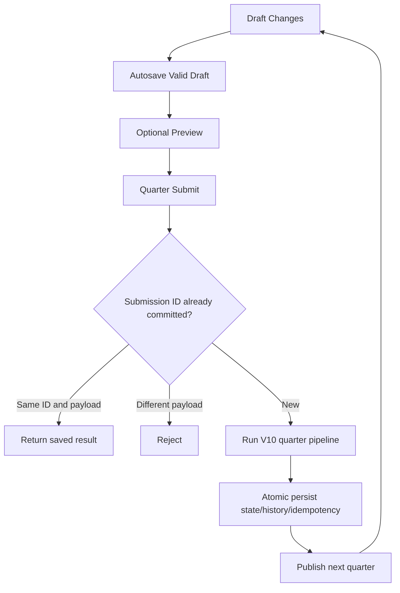

# MarketLab V12 — Mechanics Specification

## Scope and status

Target: durable single-player game sessions, using real V10 economic pipeline and V11 workspace for all market, finance and operations decisions. All save mechanics below were built as a **separate project** and are not claims about Marketplace's private implementation.

### Core state model

`PersistentGame` owns one active `GameController`, active slot ID, name, last save time, revision counter and a persistent draft.

The serialized `game` bundle contains:

1. `state`: full `BusinessState` for current quarter, including Market, Finance, Quality, Sites, Contracts, R&D and research orders.
2. `plans`: channel mix, SEO/PPC/social/offline arrangements, rebate plans.
3. `history`: immutable-reported result summaries for already closed quarters.
4. `commit_ids`: submission ID → (input hash, original result), essential for exact-once processing after restart.
5. `draft`: in-progress decisions for current quarter, or null if the 8 rounds have finished.

Slot files: `saves/slots/<uuidhex>.json`. Active slot pointer: `saves/active.json`.

Each slot file is a JSON envelope:

```json
{
  "schema": 1,
  "sha256": "checksum-of-canonical-payload",
  "payload": {
    "slot_id": "uuid-hex",
    "name": "Company name",
    "updated_at": "UTC ISO time",
    "revision": 0,
    "scenario": "marketlab-v10-reference",
    "game": "tagged-JSON-data"
  }
}
```

The `game` JSON contains tagged maps and dataclasses. This is conceptual: no plain JSON export should be hand-edited. A checksum detects changes but does not provide a cryptographic signature against an attacker who can rewrite the file.

### State machine



The preview never mutates state. Submit computes a fresh state in a transaction-like sequence and persists only after the simulator has completed successfully. A storage write error before the atomic commit rolls back memory. The same submission ID with the same input returns an earlier result after a process restart.

**Crash assumptions:** atomic replace and fsync reduce partial-save risk on typical local filesystems. They are not a full transactional database or a guarantee against all disk/filesystem corruption. Multi-process writes into one save directory are unsupported.

### Save Manager operations

| Operation | Backend | Rules |
|---|---|---|
| Get state | `GET /api/state` | Returns view-safe snapshot and current draft, slot and revision |
| List slots | `GET /api/saves` | Returns metadata; corrupt slots marked and not loadable |
| Save draft | `POST /api/draft` | Valid quarter and draft; optional optimistic `expected_revision` |
| Preview | `POST /api/preview` | Valid decisions; no change to saved state |
| Submit | `POST /api/submit` | ID per slot+quarter; durable replay protection |
| Create slot | `POST /api/saves/new` | Name 1–60 chars, `copy_current` optional |
| Load slot | `POST /api/saves/load` | Verifies checksum and type whitelist before pointer switch |
| Rename | `POST /api/saves/rename` | Name 1–60 chars; persists revision |
| Delete | `POST /api/saves/delete` | Inactive slots only |
| Restart slot | `POST /api/reset` | Clears active progress, retains other slots |

Example of draft autosave request:

```json
{"quarter": 1,"draft": {"price": 900,"other-fields": "..."},"expected_revision": 0}
```

The `draft` must contain the COMPLETE V11 decision object; abbreviated example above is not a valid input payload.

### Data and security invariants

- Only whitelisted dataclasses from the shipped simulation modules are reconstructed. Arbitrary imports and `pickle.loads` are never executed.
- Tagged tuples, sets, frozen sets and dictionaries with tuple keys round-trip without changing meaning.
- Only 8 quarterly commits are allowed in one completed game.
- Submission IDs never cause a second settlement when retried with the original payload.
- Preview cannot advance the quarter, change money or change history.
- Revision mismatch rejects a stale unsaved edit.
- Invalid drafts and failed filesystem writes must not change the in-memory state.
- `quarter == len(history)+1` after a successful load; Q9 means all eight rounds complete.
- Corrupt active save causes explicit startup failure unless `--recover` is passed; damage is not silently overwritten.
- Every HTTP mutation is localhost only and rejects non-local browser `Origin` headers. There is no authentication, so don't expose the server beyond localhost.

### Version/compatibility

V12 schema version is **1** and targets the bundled V10 reference model. Future changes to state class fields or schema require a migration script; unknown format versions fail closed. Savefiles from commercial Marketplace are unsupported.

### What is not implemented

No cloud saves, synchronization across devices, multiplayer transactions, database integration, continuous backup rotation, import of unknown save formats, or independent reconstruction of Marketplace's original AI/demand weights.
